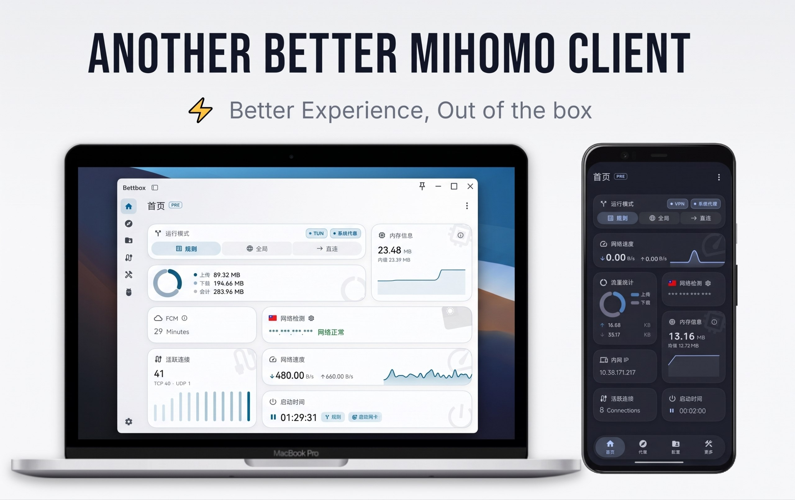

<h4 align="right">
  <a href="../README.md">简体中文</a> | <a href="README_en.md">English</a> | <a href="README_ru.md">Русский</a> | <a href="README_fa.md">فارسی</a> | <a href="README_ja.md">日本語</a> | <strong>한국어</strong>
</h4>

<h1 align="center">⚡ Bettbox</h1>
<p align="center">
  <strong>Another Better Network Toolbox</strong>
</p>

**Bettbox는 Mihomo 코어를 기반으로 한 멀티플랫폼 트래픽 라우팅 및 DNS 디버깅 도구입니다. 최고의 사용자 경험에 집중하고 장기간 안정적인 운영을 위해 설계되었으며, 가볍고 리소스를 적게 사용하며 어떠한 데이터도 수집하지 않습니다.**

Bettbox는 Better Network Toolbox를 의미합니다. 본 프로젝트는 SignPath 재단의 수동 보안 검증을 통과하였으며, Windows 버전은 OV 코드 서명 인증서를 사용합니다.

[](https://github.com/appshubcc/Bettbox/releases/latest) [](https://github.com/MetaCubeX/mihomo/releases/latest)

<p align="center">
  
</p>

---
### ✈️ Telegram 커뮤니티

[](https://t.me/bettbox_chat) [](https://t.me/appshub_channel)

---
## 🚀 핵심 특징

* **설치 즉시 사용**: 권한 안내, TUN, 관리형 분기 모드가 사전 탑재되어 설치 후 바로 사용할 수 있습니다.
* **가볍고 쾌적함**: 모바일은 저전력, 데스크톱은 백그라운드 점유율이 낮으며 UI 애니메이션도 부드럽습니다.
* **안전하고 신뢰할 수 있음**: 코어는 Mihomo 메인라인을 따르며, 각 플랫폼에서 최소한의 권한만 요청합니다.
* **강력한 안정성과 결함 허용**: 다중 플랫폼 극한 네트워크 환경의 경계 문제를 최적화하고 설정을 이중 검증하여 장기 운영에 적합합니다.
* **아키텍처 최적화**: 데스크톱에서 ARM64를 네이티브로 지원하며, 구형 기기를 위한 Compatible 버전도 지속적으로 유지보수합니다.
* **스마트 데몬**: 다중 플랫폼 스마트 시작/중지, 모바일 Doze 절전 대응, 데스크톱 다중 플랫폼 트레이 빠른 제어를 지원합니다.
* **시각적 설정**: 파라미터를 시각적으로 조정하고 변경 사항이 즉시 반영되어, 초보자도 설정을 직접 수정할 필요가 없습니다.
* **홈 위젯**: 정교하게 디자인된 다수의 내장 위젯으로 홈 화면에서 전체 실행 상태를 파악할 수 있습니다.
* **올인원 툴박스**: 전문가급 네트워크 및 DNS 분기 디버깅 도구를 내장하여 네트워크 상태를 한눈에 확인할 수 있습니다.
* **개인화 맞춤 설정**: Material Design 스타일의 다양한 컬러 테마, 커스텀 아이콘 및 타이틀, 그리고 30가지 속도 측정 애니메이션까지 지원합니다.
* **생태계 및 확장성**: 외부 JS 오버라이드 스크립트를 그래픽 인터페이스에 적용할 수 있으며, 고성능 Code-forge 에디터를 제공합니다.
* **개인정보 보호 위험 Zero**: 코드는 오픈소스이며 광고가 없습니다. CI/CD가 완전 자동화되어 공개 감사가 가능하고, 백그라운드 데이터 수집이 없습니다.
* **커뮤니티 중심**: 커뮤니티 피드백을 진지하게 받아들이고, 활발한 사용자 커뮤니티와 함께 발전하며 품질 높은 Issue에 적극 대응합니다.

---
## 🛠️ 설치 및 다운로드

플랫폼과 운영체제에 맞는 최신 설치 패키지를 **[[Releases]](https://github.com/appshubcc/Bettbox/releases)** 페이지에서 다운로드하십시오:

* **데스크톱 지원**: 
  * **Windows 8.1+:** (x64 / arm64)
  * **Linux Kernel 5.4+:** (x64 / arm64)
  * **macOS 12.0+:** (Intel / Apple Silicon)
* **모바일 및 기타**: 
  * **Android 8.0+:** (ARMv8 / ARMv7 / x86_64 / Universal) 
  * **Android TV:** 대화면 완전 최적화, ARMv7 32비트 버전 선택 가능
  * **HarmonyOS NEXT:** [[卓易通]](https://harmonyos.cool/android-app) 과 함께 안정적으로 사용 가능

**Linux 커뮤니티 유지 관리 패키지:**<br>
* **ArchLinux:** <code>yay -S bettbox-bin</code> 또는 <code>paru -S bettbox-bin</code> ([lyj404](https://github.com/lyj404/bettbox-aur) 관리)<br>
* **AMD64=v1 (호환 버전):** <code>yay -S bettbox-compatible-bin</code> 또는 <code>paru -S bettbox-compatible-bin</code> ([VillagerTom](https://github.com/VillagerTom) 관리)

---
## 💡 자주 묻는 질문

1. **설치 환경 및 호환 버전**:
   - Android 기기는 충분한 백그라운드 실행 권한이 부여되었는지 확인하십시오. 시스템 요구 사항은 Android 8.0 이상입니다.
   - 구형 데스크톱 하드웨어의 경우 CPU 명령어 세트 아키텍처에 따라 해당 Compatible 호환 버전을 선택하십시오.
   - 보안 관련: Bettbox의 모든 과정은 오픈 소스이며 투명합니다. 코드는 권위 있는 SignPath 보안 감사를 통과하였으며 개인정보 수집이 전혀 없습니다.

2. **데스크톱 권한 및 TUN**:
   - Windows 버전의 관리자 권한은 설치 프로그램에서 사전 처리되므로 일상적인 사용 시 수동으로 다시 승인할 필요가 없습니다.
   - macOS / Linux에서 TUN 가상 네트워크 카드를 활성화할 때는 시스템 안내에 따라 올바른 시스템 암호를 입력하여 승인을 완료하십시오.
   - 기타 오류 발생 시 백그라운드에서 다른 프록시 도구가 포트를 점유하고 있지 않은지 먼저 확인하고 Debug 로그를 첨부하여 피드백을 제출해 주십시오.

3. **macOS 최초 설치 가이드**:
   - 사용 중인 플랫폼(Intel / Apple Silicon)에 맞는 `.dmg` 설치 패키지를 다운로드하여 열고, Bettbox 아이콘을 Applications 폴더로 드래그합니다.
   - **시스템 보안 차단 우회** ([현재 Apple 공식 상업용 개발자 인증서는 구매하지 않았습니다](https://support.apple.com/en-us/102445)):
     - **권장**: "Finder - 응용 프로그램"에서 **Bettbox 아이콘을 마우스 오른쪽 버튼으로 클릭하고 "열기"를 선택**한 후, 시스템 팝업창에서 "열기"를 클릭합니다.
     - **대안**: 실행이 차단된 경우 시스템 "설정 -> 개인정보 보호 및 보안"으로 이동하여 Bettbox를 찾아 "확인 없이 열기"를 클릭합니다.
   - 처음 TUN 모드를 활성화할 때 시스템 암호 승인 창이 표시됩니다. 가상 네트워크 인터페이스 생성을 허용하려면 암호를 입력하십시오.

4. **구독 가져오기 및 문제 해결**:
   - 가져오기에 실패한 경우, 서비스 제공업체의 대시보드에서 구독 링크를 재설정한 후 다시 시도해 주십시오.
   - 문제가 지속되면 제공업체에 노드 형식을 확인하십시오. 클라이언트 문제로 확인되면 언제든지 Issue를 제출해 주시기 바랍니다.

---
## 💻 개발, 빌드 및 UI 적응

Windows 플랫폼 빌드를 예로 들면:

* 시스템 요구 사항: Windows 10 이상
* 필수 환경: Git, Visual Studio, Flutter 3.47.x, Golang, Inno Setup, Rust
```bash
* flutter pub get (관련 종속성 가져오기)
* dart .\setup.dart windows --arch amd64 --out core (Core 코어만 빌드)
* dart .\setup.dart windows --arch amd64 --out app --compatible (선택적 호환 버전)
* 빌드 완료 후 최종 결과물은 `dist/` 디렉토리에 위치합니다
```

사용자 지정 스크립트 UI 적응:

* Bettbox는 외부 오버라이드 스크립트의 그래픽 UI 적응을 지원합니다. AIsouler의 **[스크립트/설정 공유](https://github.com/AIsouler/MyClash)**를 예로 들면, 스크립트 첫 줄에 다음 선언을 추가하기만 하면 내장된 시각적 스위치와 직접 연동할 수 있습니다:
* <code>const Compatible_With_Bettbox = { ruleOptionsEnable: true };</code>
* 스크립트 스위치에 정책 그룹 및 기타 기능 스위치가 포함된 경우 `policyGroupOptions`를 통해 정책 그룹 스위치 이름을 선언할 수 있습니다. 선언되지 않은 스위치는 「⚙️ 기타 설정」 하위 메뉴로 자동 분류됩니다:

```js
const Compatible_With_Bettbox = {
  ruleOptionsEnable: true,
  // 정책 그룹에 속하는 스위치 이름 선언 (ruleOptionsEnable의 키와 정확히 일치해야 함)
  policyGroupOptions: ['🚀 节点选择', '🛑 广告拦截'],
};
```
* `policyGroupOptions`를 선언하지 않았거나 이름이 일치하지 않는 경우 모든 스위치가 펼쳐져 표시됩니다.

---
### 🛩️ 추천 서비스
#### IEPL 전용선  〢  [百变小樱 (BBXY)](https://www.bbxy01.com/v2/register?code=c09R)  〢  [白月光 (BaiYueGuang)](https://www.sibker.com/register?invite_code=YZq6L5zd)  〢  [Ytoo](https://y-too.net/aff.php?aff=10354)
--------------------------------
#### 저가형 직결  〢  [良心云 (Liangxin Cloud)](https://xn--9kqz23b19z.com/#/register?code=VTnrQYAj)  〢  [吹雪云 (Chuixue Cloud)](https://xn--9kqs1lo79d.com/#/register?code=skKMTab7)  〢  [一分 (YiFen)](https://xn--4gqx1hgtfdmt.com/#/register?code=AuCiXprV) 
--------------------------------
#### 百变小樱 전용 32% 할인 쿠폰 코드: bettbox68 , 참조: [관련 안내](https://t.me/appshub_channel/381)
--------------------------------

**간단 리뷰** : ❚ ❚ 위 링크는 주로 개인 사용 또는 TG 그룹 논의/추천을 기반으로 하며, 제휴(AFF) 형태로만 제공됩니다(참고: 링크를 통해 구매 시 개발자에게 소액의 수수료가 지원되어 개발에 도움이 됩니다). 이는 해당 서비스에 대한 어떠한 보증이나 약속을 의미하지 않습니다. 신중하게 검토하고 합리적으로 선택하시기 바랍니다.

---
### ☕ 후원 및 지원

**본 프로젝트가 도움이 되셨다면 다음 방법으로 개발을 후원하시거나 [추천 링크](../README.md#%EF%B8%8F-%E6%8E%A8%E8%8D%90%E6%9C%8D%E5%8A%A1)를 이용하실 수 있습니다:**

* TRON (TRC-20)： <code>TCkTtZfF2WrciZLaJj3e1aqrh3zdTnCkDa</code>
* Bitcoin： <code>bc1qu950cl6035qvllmzk6cfw3l30j2lg3cq9n6g6h</code>

---
## ❤️ 감사의 글

<table>
  <tr>
    <td>
      
    </td>
    <td>
    Free code signing on Windows provided by <a href="https://signpath.io">SignPath.io</a>, certificate by <a href="https://signpath.org/">SignPath Foundation</a>
    </td>
  </tr>
</table>

* **[FlClash GUI](https://github.com/chen08209/FlClash)** (본 프로젝트는 훌륭한 오픈소스 프로젝트인 FlClash에서 출발했습니다. 원작자의 선구적인 탐구와 기여에 경의를 표합니다)
* **[Mihomo Core](https://github.com/MetaCubeX/mihomo)** (강력하고 유연한 코어 드라이버)

본 프로젝트를 위해 기여해 주신 모든 [기여자](https://github.com/appshubcc/Bettbox/graphs/contributors) 분들과 영감 및 참고가 된 다음 오픈소스 프로젝트에 감사드립니다:

[Zashboard](https://github.com/Zephyruso/zashboard), [CMFA](https://github.com/MetaCubeX/ClashMetaForAndroid), [Sparkle](https://github.com/xishang0128/sparkle), [SFA](https://github.com/SagerNet/sing-box-for-android), [HUSI](https://github.com/xchacha20-poly1305/husi), [V2rayN](https://github.com/2dust/v2rayN), [Bett-rules](https://github.com/appshubcc/bett-rules)

---
## 📄 오픈소스 라이선스

본 프로젝트는 [GPL-3.0 License](../LICENSE) 오픈소스 라이선스를 따릅니다.
